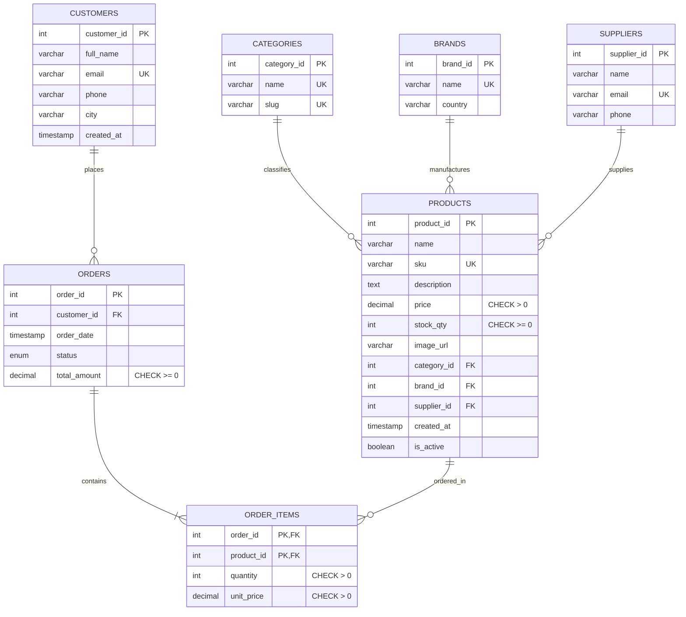

# ⚡ Voltcart — Electronics Store DBMS

A production-grade, relational Database Management System (DBMS) web application for **Voltcart**, a specialized electronics store retailing phones, computing hardware, audiophile acoustics, mirrorless cameras, and premium desktop gear.

Built with a **3NF-normalized MySQL** cloud database architecture, **Node.js + Express** REST backend using `mysql2` connection pooling with TLS/SSL encryption, and a custom **vanilla web frontend** engineered with a confident, editorial tech-retail aesthetic (Archivo & DM Sans typography, tactile controls, and electric orange accents).

---

## 📑 Table of Contents
1. [Architecture & Technology Stack](#-architecture--technology-stack)
2. [Database Design (3NF Normalization)](#-database-design-3nf-normalization)
3. [Entity-Relationship (ER) Diagram](#-entity-relationship-er-diagram)
4. [Triggers, Views & Atomic Transactions](#-triggers-views--atomic-transactions)
5. [Step-by-Step Cloud MySQL Setup Guide](#-step-by-step-cloud-mysql-setup-guide)
6. [Local Installation & Execution](#-local-installation--execution)
7. [REST API Documentation](#-rest-api-documentation)
8. [8 Sample SQL Queries for Examiner Demo](#-8-sample-sql-queries-for-examiner-demo)
9. [Project File Structure](#-project-file-structure)

---

## 🛠️ Architecture & Technology Stack

| Layer | Technology | Key Details |
|---|---|---|
| **Database** | MySQL 8.0+ (InnoDB, `utf8mb4`) | 3NF normalized, strict FKs, check constraints, composite PKs, triggers, and views |
| **Backend** | Node.js 18+ & Express 4 | RESTful architecture, parameterised queries, connection pooling, SSL support |
| **Database Driver**| `mysql2/promise` | Native async/await support, connection pool, SSL cipher support |
| **Frontend** | Vanilla HTML5, CSS3, JavaScript (ES6+) | No React, no build step, no CSS frameworks; served directly via Express `/public` |
| **Design Language**| Custom Hardware Editorial | Archivo + DM Sans typography, `#F7F5F0` warm off-white, `#E8541E` electric orange |

---

## 🗄️ Database Design (3NF Normalization)

The database strictly conforms to **Third Normal Form (3NF)**:

1. **First Normal Form (1NF)**:
   - All columns hold atomic, scalar values (no repeating groups, comma-separated lists, or composite records).
   - Each table possesses an explicit primary key (`category_id`, `brand_id`, `supplier_id`, `product_id`, `customer_id`, `order_id`, and composite PK `(order_id, product_id)`).
2. **Second Normal Form (2NF)**:
   - The database satisfies 1NF.
   - All non-key attributes are fully functionally dependent on the entire primary key. In `order_items`, attributes `quantity` and `unit_price` depend upon the composite key `(order_id, product_id)` as a whole.
3. **Third Normal Form (3NF)**:
   - The database satisfies 2NF.
   - Eliminates transitive dependencies:
     - Customer details (`full_name`, `email`, `city`) reside solely in `customers`, referenced in `orders` via `customer_id`.
     - Brand and supplier details reside in dedicated normalized tables (`brands`, `suppliers`) rather than being duplicated inside `products`.
     - `order_items.unit_price` stores the immutable price snapshot at the moment of checkout, ensuring historical financial records remain intact even when catalog prices change in `products`.

### Deliberate Foreign Key Rules:
- `products.category_id` & `products.brand_id`: `ON DELETE RESTRICT` (prevents deleting active categories or brands that hold products).
- `products.supplier_id`: `ON DELETE SET NULL` (allows distributor relationships to retire without wiping out product listings).
- `orders.customer_id`: `ON DELETE RESTRICT` (protects financial history; customer profiles with orders cannot be dropped).
- `order_items.order_id`: `ON DELETE CASCADE` (purging an order cleans up its line items).
- `order_items.product_id`: `ON DELETE RESTRICT` (a product present in customer orders cannot be deleted; backend performs soft-deletion via `is_active = FALSE`).

---

## 📊 Entity-Relationship (ER) Diagram



---

## ⚙️ Triggers, Views & Atomic Transactions

### 1. Database Trigger: `trg_reduce_product_stock`
Executed `BEFORE INSERT ON order_items`.
- Atomically inspects current `stock_qty` in `products` using row-level locking (`FOR UPDATE`).
- Rejects checkout with SQLSTATE `'45000'` (`Insufficient stock for the requested product`) if `stock_qty < NEW.quantity`.
- Automatically deducts inventory quantity: `stock_qty = stock_qty - NEW.quantity`.

### 2. View: `v_order_summary`
An aggregated relational view joining `orders`, `customers`, and `order_items`. Provides instantaneous order metrics, total quantity of items, and customer information without writing repetitive `JOIN` and `GROUP BY` logic in the application.

```sql
SELECT 
    o.order_id,
    c.full_name AS customer_name,
    c.city AS customer_city,
    o.order_date,
    o.status,
    COALESCE(SUM(oi.quantity), 0) AS item_count,
    o.total_amount
FROM orders o
JOIN customers c ON o.customer_id = c.customer_id
LEFT JOIN order_items oi ON o.order_id = oi.order_id
GROUP BY o.order_id, c.full_name, c.city, o.order_date, o.status, o.total_amount;
```

### 3. Atomic Order Placement (Transaction)
Order placement is completely atomic across `orders`, `order_items`, and inventory reductions:
1. `connection.beginTransaction()`
2. Row-locks inventory rows (`SELECT ... FOR UPDATE`)
3. Validates stock availability for every cart item
4. Inserts parent record into `orders`
5. Inserts line items into `order_items` (firing trigger `trg_reduce_product_stock`)
6. Calculates verified line sum and finalizes `orders.total_amount`
7. `connection.commit()`
8. On any violation or failure (e.g. out of stock, constraint mismatch), triggers an immediate `connection.rollback()` ensuring zero partial or corrupted orders.

---

## ☁️ Step-by-Step Cloud MySQL Setup Guide

You can host the MySQL database on any modern cloud database provider (e.g., **Aiven**, **TiDB Cloud**, **Railway**, **PlanetScale**, **Clever Cloud**, or **AWS RDS**).

### Example with Aiven / TiDB Cloud / Railway:
1. **Create Free MySQL Service**:
   - Go to [Aiven.io](https://aiven.io/) or [TiDB Cloud](https://tidbcloud.com/) or [Railway.app](https://railway.app/).
   - Create a free MySQL database instance (e.g., named `voltcart_db`).
2. **Configure Network Access**:
   - In your cloud dashboard, find **Network** or **IP Allowlist**.
   - Add your current IP or allow `0.0.0.0/0` (standard for development / university demos).
3. **Download SSL Certificate or Note SSL Requirement**:
   - Cloud providers mandate SSL/TLS.
   - Voltcart's backend automatically enables SSL when `DB_SSL=true` is set.
4. **Import Schema & Seed Data**:
   - Connect via MySQL CLI, MySQL Workbench, DBeaver, or phpMyAdmin:
     ```bash
     mysql -h <CLOUD_HOST> -P <CLOUD_PORT> -u <CLOUD_USER> -p <CLOUD_DB> < schema.sql
     mysql -h <CLOUD_HOST> -P <CLOUD_PORT> -u <CLOUD_USER> -p <CLOUD_DB> < seed.sql
     ```
   - *Or* open `schema.sql` and run all queries, then open `seed.sql` and execute all queries.
5. **Configure Environment Variables**:
   - Copy `.env.example` to `.env`:
     ```bash
     cp .env.example .env
     ```
   - Update `.env` with your cloud credentials:
     ```env
     PORT=3000
     DB_HOST=your-cloud-host.aivencloud.com
     DB_PORT=13306
     DB_USER=avnadmin
     DB_PASSWORD=your_secure_password
     DB_NAME=voltcart_db
     DB_SSL=true
     ```

---

## 🚀 Local Installation & Execution

### Prerequisites:
- Node.js 18.0+ installed
- MySQL 8.0+ running (Cloud or Local)

### 1. Install Dependencies
```bash
npm install
```

### 2. Configure `.env`
Ensure `.env` exists with valid credentials (see [Cloud Setup](#-step-by-step-cloud-mysql-setup-guide)).

### 3. Start the Server
```bash
npm start
```
*Or during development with auto-reload:*
```bash
npm run dev
```

### 4. Open in Browser
Visit **`http://localhost:3000`** in your browser.
- **Shop Catalog**: Browse 30 hardware items, filter by category/brand, search, and sort.
- **Product Details**: Click any item card to inspect hardware specs and stock status.
- **Cart & Checkout**: Add items, modify quantities, select an existing customer or enter a new customer, and execute atomic transactions.
- **Admin Dashboard**: Click **Admin** in the header to view live sales analytics, manage products (CRUD with soft-delete safeguards), inspect orders & update statuses, and manage customer accounts.

---

## 📡 REST API Documentation

### Products
- `GET /api/products`: Query params: `search`, `category`, `brand`, `sort` (`newest`, `price_asc`, `price_desc`, `name_asc`), `page`, `limit=12`, `all=true`.
- `GET /api/products/:id`: Detailed specs of a single product with category and brand details.
- `POST /api/products`: Add product (validates price > 0, stock >= 0, unique SKU).
- `PUT /api/products/:id`: Update existing product details.
- `DELETE /api/products/:id`: Safeguarded deletion. If product appears in existing customer orders, the backend blocks hard deletion and performs a **soft delete** (`is_active = FALSE`) to protect audit trails.

### Categories & Brands
- `GET /api/categories`: Returns 6 categories with active product counts.
- `GET /api/brands`: Returns 8 hardware brands with active product counts.
- `GET /api/suppliers`: Returns inventory suppliers list.

### Customers
- `GET /api/customers`: Returns customers with order volume and lifetime spend.
- `POST /api/customers`: Register new customer with email uniqueness validation.
- `PUT /api/customers/:id`: Update customer contact details.

### Orders
- `GET /api/orders`: Query params: `status`, `customer_id`. Uses view `v_order_summary`.
- `GET /api/orders/:id`: Full order invoice with customer profile and all line items with unit prices.
- `POST /api/orders`: Atomic transactional order placement with row-level locks and inventory reduction.
- `PATCH /api/orders/:id/status`: Update status (`pending`, `paid`, `shipped`, `delivered`, `cancelled`).

### Analytics & Stats
- `GET /api/stats`: Comprehensive dashboard metrics calculated via SQL aggregations:
  - Total revenue (excluding cancelled orders)
  - Total orders count and pending orders
  - Low-stock inventory alert list (`stock_qty < 5`)
  - Top 5 selling products via `JOIN` and `GROUP BY`

---

## 🎓 8 Sample SQL Queries for Examiner Demo

These queries demonstrate relational algebra, multi-table joins, subqueries, grouping, filtering, and database view operations.

### Query 1: Multi-Table INNER JOIN (Catalog with Brand & Category)
*Demonstrates standard normalization join across three tables.*
```sql
SELECT 
    p.product_id,
    p.name AS product_name,
    p.sku,
    b.name AS brand_name,
    b.country AS brand_country,
    c.name AS category_name,
    p.price,
    p.stock_qty
FROM products p
INNER JOIN brands b ON p.brand_id = b.brand_id
INNER JOIN categories c ON p.category_id = c.category_id
WHERE p.is_active = TRUE
ORDER BY p.price DESC;
```

### Query 2: Aggregate Sales with GROUP BY & SUM
*Calculates total revenue and units sold per category.*
```sql
SELECT 
    c.name AS category_name,
    COUNT(DISTINCT oi.order_id) AS orders_count,
    SUM(oi.quantity) AS total_units_sold,
    SUM(oi.quantity * oi.unit_price) AS gross_revenue
FROM categories c
JOIN products p ON c.category_id = p.category_id
JOIN order_items oi ON p.product_id = oi.product_id
JOIN orders o ON oi.order_id = o.order_id
WHERE o.status != 'cancelled'
GROUP BY c.category_id, c.name
ORDER BY gross_revenue DESC;
```

### Query 3: HAVING Clause (High-Value Customers)
*Filters grouped results to identify customers who have spent over ₹50,000.*
```sql
SELECT 
    c.customer_id,
    c.full_name,
    c.email,
    c.city,
    COUNT(o.order_id) AS total_orders_placed,
    SUM(o.total_amount) AS lifetime_expenditure
FROM customers c
JOIN orders o ON c.customer_id = o.customer_id
WHERE o.status != 'cancelled'
GROUP BY c.customer_id, c.full_name, c.email, c.city
HAVING SUM(o.total_amount) > 50000.00
ORDER BY lifetime_expenditure DESC;
```

### Query 4: Subquery in WHERE Clause (Products Priced Above Category Average)
*Uses a correlated subquery to find premium hardware within each category.*
```sql
SELECT 
    p.product_id,
    p.name,
    p.category_id,
    p.price
FROM products p
WHERE p.price > (
    SELECT AVG(p2.price)
    FROM products p2
    WHERE p2.category_id = p.category_id
)
ORDER BY p.category_id, p.price DESC;
```

### Query 5: Querying the Database VIEW (`v_order_summary`)
*Demonstrates clean data abstraction using the view.*
```sql
SELECT 
    order_id,
    customer_name,
    customer_city,
    order_date,
    status,
    item_count,
    total_amount
FROM v_order_summary
WHERE status IN ('paid', 'shipped', 'delivered')
ORDER BY total_amount DESC;
```

### Query 6: Inventory Stock Alert (< 5 Units) with Supplier Contacts
*Finds vulnerable stock and distributor contact information for restocking.*
```sql
SELECT 
    p.product_id,
    p.name AS hardware_name,
    p.sku,
    p.stock_qty,
    b.name AS brand,
    COALESCE(s.name, 'No Supplier Assigned') AS supplier_name,
    s.email AS supplier_email,
    s.phone AS supplier_phone
FROM products p
JOIN brands b ON p.brand_id = b.brand_id
LEFT JOIN suppliers s ON p.supplier_id = s.supplier_id
WHERE p.stock_qty < 5 AND p.is_active = TRUE
ORDER BY p.stock_qty ASC;
```

### Query 7: Top 5 Best-Selling Products by Sales Volume
*Demonstrates multi-table join aggregation with ordering and limit.*
```sql
SELECT 
    p.product_id,
    p.name AS product_name,
    b.name AS brand,
    c.name AS category,
    SUM(oi.quantity) AS total_units_sold,
    SUM(oi.quantity * oi.unit_price) AS total_sales_inr
FROM products p
JOIN order_items oi ON p.product_id = oi.product_id
JOIN orders o ON oi.order_id = o.order_id
JOIN brands b ON p.brand_id = b.brand_id
JOIN categories c ON p.category_id = c.category_id
WHERE o.status != 'cancelled'
GROUP BY p.product_id, p.name, b.name, c.name
ORDER BY total_units_sold DESC
LIMIT 5;
```

### Query 8: Order Fulfillment Pipeline Breakdown
*Summarizes orders by status with percentage breakdown.*
```sql
SELECT 
    status,
    COUNT(*) AS order_count,
    SUM(total_amount) AS total_value,
    ROUND((COUNT(*) * 100.0 / (SELECT COUNT(*) FROM orders)), 2) AS percentage_of_orders
FROM orders
GROUP BY status
ORDER BY order_count DESC;
```

---

## 📁 Project File Structure

```
c:/Users/Acer/Documents/Rohan/
├── .env.example              # Template configuration for Cloud MySQL & Port
├── .env                      # Local environment configuration (User-created)
├── package.json              # Express, mysql2, cors, dotenv dependencies
├── schema.sql                # 3NF DDL (Tables, Constraints, Indexes, Views, Triggers, Procedures)
├── seed.sql                  # DML (6 categories, 8 brands, 3 suppliers, 30 products, 10 customers, 12 orders)
├── README.md                 # Complete documentation, setup guide & examiner queries
├── server/
│   ├── db.js                 # mysql2 connection pool with SSL cipher configuration
│   ├── index.js              # Express app, middleware, routes, and /public static server
│   └── routes/
│       ├── products.js       # Product CRUD, filters, search, pagination, soft-delete
│       ├── categories.js     # Category listings with product counts
│       ├── brands.js         # Brand listings with product counts
│       ├── suppliers.js      # Supplier directory
│       ├── customers.js      # Customer accounts and lifetime spend
│       ├── orders.js         # Atomic transaction order creation, view queries, status patch
│       └── stats.js          # Aggregated analytics, low stock alerts, best sellers
└── public/
    ├── index.html            # Semantic HTML5 layout (Shop, Detail Modal, Cart, Admin)
    ├── css/
    │   └── style.css         # Custom tactile design system (Archivo, DM Sans, electric orange)
    ├── js/
    │   └── app.js            # Vanilla SPA router, cart state, dynamic DOM, modal management
    └── images/
        └── placeholder.svg   # Scalable hardware SVG image fallback
```
